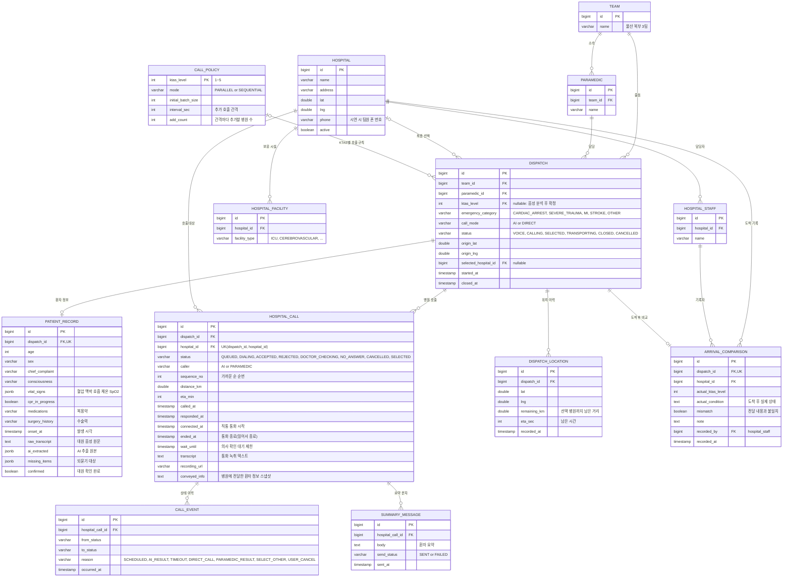
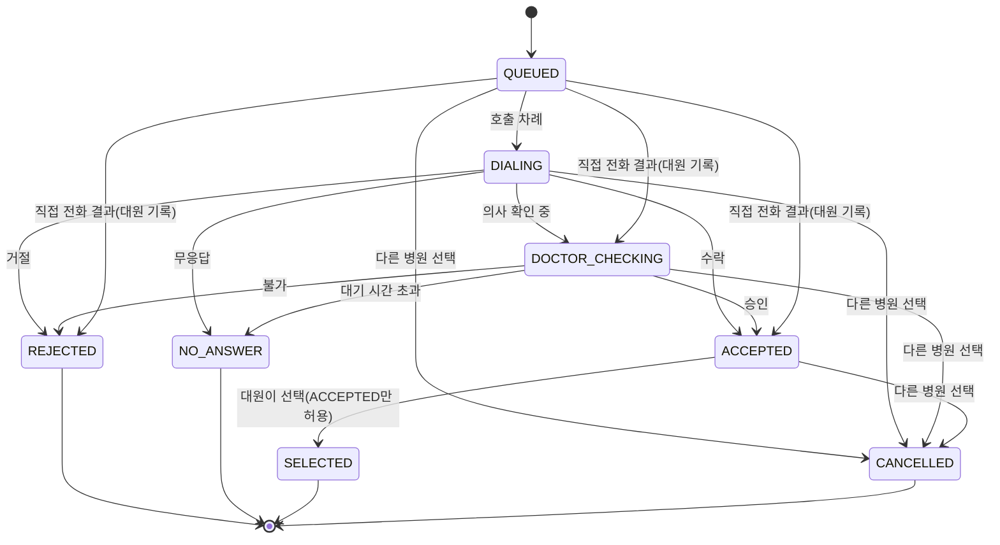

# Call91 Backend (Server)

응급실 뺑뺑이를 줄이기 위한 **병원 입장을 반영한 응급 이송 매칭** 서비스의 백엔드 서버.
구급대원 앱(React Native)이 환자 정보를 말하면, 서버가 병원 후보를 계산하고 AI 전화 호출·응답·상태를 관리한다.

> 근거 자료: 팀 콜나인원 설계 보완 발표(2026 AI 캡스톤), 응급 이송 매칭 목업.
> 아래 "가정" 표시는 자료에 없어 임의로 정한 부분이다.

## 1. 역할과 구조

```
[App: React Native]  --REST / WebSocket-->  [Server: Spring]  --HTTP-->  [AI: Python, H100]
  구급대원 / 병원(시연용 폰)                  후보 계산 · 상태 관리 · 기록        STT · LLM · TTS · 발신
```

| 저장소 | 스택 | 책임 |
|---|---|---|
| App | React Native (Expo) | 음성 녹음, GPS, 4단계 화면 (음성 호출 → 병원 호출 → 병원 선택 → 이송) |
| **Server (이 저장소)** | Spring Boot 3 / Java 21 / PostgreSQL (인증 없음, 시연용) | 병원 후보 계산, KTAS 묶음 호출 스케줄, 호출 상태 머신, 기록 저장, 실시간 푸시 |
| AI | Python (학교 H100) | 음성 → 항목 추출, 빠진 항목 되묻기, 병원 통화 대본·TTS, 응답 4종 분류 |

시연은 학교망 안에서 팀원 폰을 병원으로 쓴다. 실제 병원 번호로는 발신하지 않는다.

## 2. 서버 파일 트리

기능(도메인) 단위 패키지 구조. 각 패키지는 `controller / service / repository / domain / dto`로 나눈다.

```
Backend/
├── build.gradle
├── settings.gradle
├── docker-compose.yml                  # 로컬 PostgreSQL
├── README.md
└── src/
    ├── main/
    │   ├── java/com/call91/
    │   │   ├── Call91Application.java
    │   │   │
    │   │   ├── global/
    │   │   │   ├── config/             # WebSocketConfig, AiClientConfig
    │   │   │   ├── web/                # ActorHeaderResolver (X-Paramedic-Id / X-Hospital-Staff-Id)
    │   │   │   ├── error/              # ErrorCode, GlobalExceptionHandler
    │   │   │   └── common/             # BaseTimeEntity, GeoUtil(Haversine 거리)
    │   │   │
    │   │   ├── team/                   # 구급대(팀)
    │   │   ├── paramedic/              # 구급대원
    │   │   │
    │   │   ├── hospital/
    │   │   │   ├── domain/             # Hospital, HospitalFacility, HospitalStaff
    │   │   │   ├── service/            # HospitalCandidateService (시설 필터 + 가까운 순 정렬)
    │   │   │   └── controller/
    │   │   │
    │   │   ├── dispatch/               # 출동 1건의 생명주기
    │   │   │   ├── domain/             # Dispatch, DispatchStatus, DispatchLocation
    │   │   │   ├── service/            # 출동 생성 · 병원 확정 · 출동 종료 · 위치 갱신/남은 거리·시간 계산
    │   │   │   └── controller/
    │   │   │
    │   │   ├── patient/                # 음성 → 항목 추출 결과, 대원 확인/수정
    │   │   │   ├── domain/             # PatientRecord
    │   │   │   ├── service/            # 빠진 항목 판단, 이상값 경고
    │   │   │   └── controller/
    │   │   │
    │   │   ├── call/                   # 서버의 핵심: 병원 호출
    │   │   │   ├── domain/             # HospitalCall, CallEvent, CallPolicy, 상태 enum
    │   │   │   ├── service/
    │   │   │   │   ├── CallPlanner         # KTAS 정책대로 다음에 부를 병원 선택
    │   │   │   │   ├── CallScheduler       # 30초/60초 간격 추가 호출, 의사 확인 대기 타임아웃
    │   │   │   │   ├── CallStateMachine    # 허용된 상태 전이만 통과, CallEvent 기록
    │   │   │   │   └── DirectCallService   # 직접 전화 시 해당 병원 AI 발신 중단
    │   │   │   └── controller/         # 대원용 API + AI 결과 콜백(Webhook)
    │   │   │
    │   │   ├── ai/                     # Python AI 서버 호출 클라이언트와 DTO
    │   │   │   ├── AiClient
    │   │   │   └── dto/                # ExtractRequest/Response, CallRequest, CallResultCallback
    │   │   │
    │   │   ├── notification/           # WebSocket(STOMP) 상태 푸시, 통화 후 환자 요약 문자
    │   │   │   ├── RealtimePublisher
    │   │   │   └── SummaryMessageService
    │   │   │
    │   │   └── record/                 # 병원 보호용 기록
    │   │       ├── domain/             # ArrivalComparison (전달 내용 vs 실제 상태)
    │   │       ├── service/
    │   │       └── controller/
    │   │
    │   └── resources/
    │       ├── application.yml
    │       ├── application-local.yml
    │       └── db/migration/
    │           ├── V1__init_schema.sql
    │           └── V2__seed_hospitals_and_call_policy.sql   # 울산 병원 + KTAS 호출 정책
    │
    └── test/java/com/call91/
        ├── call/                       # CallPlanner, CallStateMachine 단위 테스트
        ├── hospital/                   # 후보 정렬·시설 필터 테스트
        └── dispatch/                   # 호출 → 선택 → 종료 통합 테스트
```

## 3. ERD



설계 포인트
- **`hospital_call`이 중심**이다. 출동 1건 × 병원 1곳의 호출 한 줄이며, 수락/거절/의사 확인 중/무응답 4종과 직접 전화 여부(`caller`)가 여기에 있다.
- **`conveyed_info`·`transcript`·`call_event`·`arrival_comparison`**은 분쟁 시 병원의 근거 자료다. `call_event`는 append-only, `transcript`·`recording_url`은 AI 콜백으로 한 번 채워진 뒤에는 수정하지 않는다. 같은 병원에 재통화가 생기면 같은 `hospital_call`에 `call_event`로 이어 기록한다(`dispatch_id + hospital_id` 유일).
- **`call_policy`는 테이블**로 둔다. KTAS 3단계 처리가 미정이라, 코드 수정 없이 값만 바꾸기 위해서다.
- 병원 시설은 `hospital_facility`로 분리해 목업의 "필요 시설"(ICU, 뇌혈관, 중독·약물 등)로 후보를 거른다.

## 4. 호출 규칙 (KTAS)

| KTAS | 모드 | 처음 호출 | 이후 | 비고 |
|---|---|---|---|---|
| 1 소생 | PARALLEL | 3곳 | 30초마다 +2곳 | 심정지는 처음부터 DIRECT 선택 가능 |
| 2 긴급 | PARALLEL | 2곳 | 60초마다 +2곳 | |
| 3 응급 | 미정 | - | - | 중증/경증 처리 확정 필요. 임시로 2단계와 동일 (가정) |
| 4~5 | SEQUENTIAL | 1곳 | 응답 후 다음 1곳 | |

후보는 필요 시설을 가진 병원 중 **가까운 순**(출발 좌표 기준)으로 정렬한다.
`DOCTOR_CHECKING`은 `wait_until`까지 기다리되 그동안에도 다음 병원 호출은 계속한다. 시간이 지나면 `NO_ANSWER`로 바꾼다.

### 호출 상태 전이



`DOCTOR_CHECKING`의 최종 회신(승인/불가)은 AI 재통화 또는 대원 기록으로 같은 콜백/`result` API를 한 번 더 호출해 반영한다. SEQUENTIAL(4~5단계)에서도 `DOCTOR_CHECKING`은 응답으로 보고 다음 병원을 부르되, 이 병원의 회신은 계속 받는다. 첫 `ACCEPTED`가 나오면 새 묶음 확대(+N곳)는 멈추고, 이미 건 호출의 응답은 계속 받는다(목업 기준). 선택 시 나머지는 `CANCELLED`로 바꾸며 AI가 취소를 알린다. 심정지 `DIRECT` 모드는 `CallPolicy`를 쓰지 않고 `HOSPITAL_CALL`을 대원이 고른 병원 순서로 만든다.

직접 전화는 상태가 아니라 `caller = PARAMEDIC` 로 표시한다. 누르는 순간 서버가 AI에 해당 병원 발신 중단을 요청하고, 나머지 병원은 계속 호출한다.

## 5. 주요 API (초안)

| 구분 | Method | Path | 설명 |
|---|---|---|---|
| 설정 | GET | `/api/me?paramedicId=` | 헤더용 팀·대원 정보 (로그인 없음, ID는 앱 설정값) |
| 출동 | POST | `/api/dispatches` | 출동 시작 (위치, 팀) |
| 환자 | POST | `/api/dispatches/{id}/voice` | 음성 업로드 → AI 항목 추출, 빠진 항목 반환 |
| 환자 | PUT | `/api/dispatches/{id}/patient` | 대원이 확인·수정 후 확정 |
| 호출 | POST | `/api/dispatches/{id}/calls/start` | KTAS 정책대로 병원 호출 시작 |
| 호출 | GET | `/api/dispatches/{id}/calls` | 병원별 호출 상태 (수락 병원 우선 정렬) |
| 호출 | POST | `/api/calls/{callId}/direct` | 직접 전화 (해당 병원 AI 중단) |
| 호출 | POST | `/api/calls/{callId}/result` | 직접 통화 결과를 탭 한 번으로 기록 |
| 호출 | DELETE | `/api/dispatches/{id}/calls` | 전체 호출 취소 |
| 선택 | POST | `/api/dispatches/{id}/select` | ACCEPTED 호출만 확정 가능, 나머지 호출 자동 취소 |
| 위치 | PUT | `/api/dispatches/{id}/location` | 구급차 GPS 갱신, 선택 병원까지 남은 거리·시간 반환 (이송 화면) |
| 종료 | POST | `/api/dispatches/{id}/close` | 이송 완료 · 출동 종료 |
| 기록 | POST | `/api/dispatches/{id}/arrival` | 병원이 실제 상태 입력 (전달 내용과 비교) |
| AI 콜백 | POST | `/internal/ai/call-result` | AI → 서버, 응답 4종 분류 결과 |
| 실시간 | WS | `/ws` → `/topic/dispatches/{id}` | 호출 상태 변경을 앱에 푸시 |

## 6. 서버 ↔ AI 데이터 형식 (확정 필요)

발표 자료에서 "데이터 형식 확정(서버와)"이 다음 단계로 남아 있다. 서버는 아래 모양을 가정한다.

```jsonc
// 서버 → AI : 항목 추출
POST {ai}/extract   { "transcript": "..." }
→ { "ktasLevel": 1, "category": "CARDIAC_ARREST", "warnings": ["혈압 이상값"], "items": { "age": 60, "sex": "M", ... }, "missing": ["medications", "surgeryHistory"] }

// 서버 → AI : 병원 발신
POST {ai}/call      { "callId": 12, "hospitalPhone": "...", "script": { "ktas": 1, "age": 60, "chiefComplaint": "..." } }

// 서버 → AI : 발신 중단 (직접 전화 / 다른 병원 선택 / 전체 취소)
POST {ai}/call/{callId}/cancel

// AI → 서버 : 결과 콜백 (의사 확인 후 재통화 시 같은 callId로 한 번 더)
POST /internal/ai/call-result
{ "callId": 12, "result": "ACCEPTED | REJECTED | DOCTOR_CHECKING | NO_ANSWER", "transcript": "...", "recordingUrl": "..." }
```

## 7. 남은 결정

- KTAS 3단계 호출 방식과 4대 응급(심정지·중증외상·급성심근경색·뇌졸중) 분류 기준 확정
- 병원 측 앱 사용 여부: 시연은 팀원 폰이 병원 역할이라 `hospital_staff` + WebSocket으로 가정했다 (가정)
- 로그인·인증은 시연 범위에서 제외했다. 목업에 로그인·선택 화면이 없어, 앱이 설정값(대원 ID / 병원 ID)을 요청 헤더(`X-Paramedic-Id`, `X-Hospital-Staff-Id`)에 실어 보낸다. 시연 대원·병원 데이터는 시드로 넣는다. 기록이 분쟁 근거가 되므로 실서비스 전환 시 인증·권한은 반드시 추가해야 한다 (가정)
- 문자 요약 전송 경로: 학교망은 외부 전화망 연동이 어려우므로 시연에서는 병원 앱 푸시로 대체 (가정)
- 도착 기록(`/arrival`)은 선택된 병원의 담당자만 가능하도록 검증 (가정)
- 소송 보호·인력 보충은 제도 과제로 제언하며 서버 구현 범위에 넣지 않음
